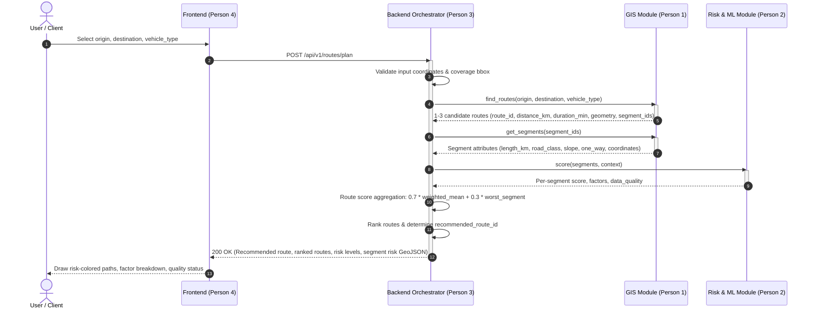

# Smart Logistics Intelligence: System Architecture

**Owner:** Person 3 (Backend)  
**Sprint Focus:** 6-Day Route-Risk MVP Sprint

---

## 1. System Overview

The **Smart Logistics Intelligence** platform provides dynamic route risk assessment for freight and transport vehicles operating in complex geographical environments (starting with the Guwahati–Shillong corridor).

The system integrates four distinct functional components owned by a 4-person team:
1. **Frontend (Person 4):** Next.js / Leaflet web interface allowing users to select origin, destination, vehicle type, and departure time, displaying risk-colored routes and contributing risk factors.
2. **Backend Orchestrator (Person 3):** Central API service implementing `/api/v1` contract, orchestrating routing candidates from GIS, evaluating risk across segments, aggregating route scores, ranking alternatives, and enforcing data quality standards.
3. **GIS & Routing Engine (Person 1):** Road network graph, snapping coordinates to nodes, Dijkstra / A* multi-candidate path finding, and road segment attribute extraction.
4. **Risk & ML Module (Person 2):** Segment-level risk scoring using rules-based baseline and trained ML models (logistic regression / random forest), integrating weather features, terrain slopes, and historical disaster events.

---

## 2. End-to-End Data Flow



---

## 3. Component Architecture & Backend Modules

The backend is built with **FastAPI** for high performance, standard async support, and automatic OpenAPI schema validation.

```
backend/
├── app/
│   ├── api/
│   │   └── v1/
│   │       ├── api.py                   # Central API v1 router
│   │       └── endpoints/
│   │           ├── routes.py            # POST /api/v1/routes/plan
│   │           ├── health.py            # GET /api/v1/health
│   │           └── meta.py              # GET /api/v1/meta/coverage
│   ├── core/
│   │   ├── config.py                # Environment configurations (pydantic-settings)
│   │   └── errors.py                # Custom domain exceptions & global exception handlers
│   ├── schemas/
│   │   ├── common.py                # Coordinates, BoundingBox, ErrorResponse
│   │   ├── route_plan.py            # RoutePlanRequest, RoutePlanResponse, Route, Segment
│   │   ├── health.py                # HealthResponse, ModuleStatus
│   │   └── meta.py                  # CoverageResponse
│   ├── services/
│   │   ├── gis_service.py           # GIS client/adapter: find_routes, get_segments
│   │   ├── risk_service.py          # Risk scorer adapter: baseline & model switch
│   │   └── orchestrator.py          # Core orchestration, aggregation & ranking engine
│   └── main.py                      # FastAPI application entrypoint with middleware
├── tests/
│   ├── conftest.py                  # Test fixtures and test client
│   ├── test_health.py               # Health checks (200 OK & 503 down)
│   ├── test_coverage.py             # Coverage bounding box tests
│   └── test_routes_plan.py          # Plan endpoint validation, scoring, fallback tests
└── requirements.txt
```

---

## 4. Key Architectural Decisions

### 4.1. Error Shape Standardization
Every error returned by the backend matches the unified schema:
```json
{
  "error": {
    "code": "STRING_IDENTIFIER",
    "message": "Human readable summary",
    "details": {}
  }
}
```
Global exception handlers in `app/core/errors.py` intercept Pydantic validation errors (`RequestValidationError`), HTTP exceptions, domain exceptions, and unhandled errors, transforming them into this shape with appropriate HTTP status codes (400, 404, 422, 503, 500).

### 4.2. Route Scoring Formula
Route risk is aggregated from segment scores using the defined weighting formula:
$$\text{weighted\_mean} = \frac{\sum_{i=1}^n (\text{length}_i \times \text{risk\_score}_i)}{\sum_{i=1}^n \text{length}_i}$$
$$\text{route\_risk\_score} = \text{round}(0.7 \times \text{weighted\_mean} + 0.3 \times \max_{i} (\text{risk\_score}_i))$$

Risk score levels:
- **Low Risk:** 0 – 33
- **Medium Risk:** 34 – 66
- **High Risk:** 67 – 100

### 4.3. Missing Data & Weather Degradation
Missing data is never scored as safe (0 risk):
- If the weather provider fails or data is unavailable, the risk scorer evaluates road geometry, slope, and historical disruptions, flags the route `data_quality` as `"partial"`, and attaches the factor `{"name": "weather_unavailable", "contribution": 0, "detail": "Weather data could not be fetched; score uses road and history factors only."}`.
- If the Risk or GIS core module is down, the system rejects the request with `503 DEPENDENCY_UNAVAILABLE` rather than generating unreliable mock risk scores.

### 4.4. Decoupled Model / Baseline Switch
Both the baseline rules scorer and the Day 5 trained ML model expose identical signatures:
`score(segments: list[dict], context: dict) -> dict[str, dict]`
Person 3 switches between baseline and trained model via configuration (`RISK_SOURCE=baseline` or `RISK_SOURCE=model`).
If the model fails to load or execute, the backend automatically falls back to baseline and sets `risk_source="baseline"`.
