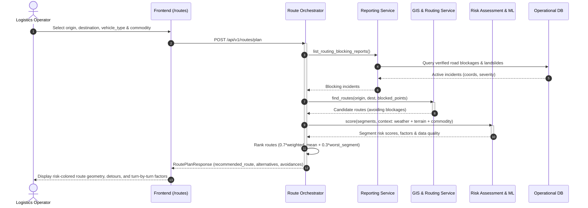

# NER-ResQ: System Architecture & Data Flow

**Platform:** Smart Logistics Intelligence (NER-ResQ)  
**Corridor Focus:** Guwahati–Shillong Corridor (NH-6) & Northeast India  

---

## 1. System Overview

The **Smart Logistics Intelligence (NER-ResQ)** platform provides AI-enabled road accessibility monitoring, dynamic hazard-aware routing, essential commodities supply tracking, live GPS fleet telemetry, and field incident verification for disaster-prone logistics corridors.

The platform integrates 5 core functional tiers:
1. **Client & Presentation Layer (Next.js 16 + Tailwind):** Interactive maps, route planner with cargo sensitivity priority, live vehicle tracking via WebSockets, essential consignment milestone management, and field report photo uploads.
2. **Backend API Gateway & Static Server (FastAPI + Uvicorn):** Serves `/api/v1` REST endpoints, WebSocket `/ws/vehicles` streaming, and static uploaded media (`/uploads`).
3. **Service Orchestration Layer:** Coordinates route multi-criteria ranking, incident-aware detours around reported blockages, fleet telemetry simulations, and consignment lifecycle progression.
4. **Spatial, ML & Environmental Engines:** Integrates native raster Copernicus DEM elevation/slope/ruggedness analysis, Open-Meteo weather forecasts at Time-of-Arrival (ToA), and machine-learned risk assessment.
5. **Operational Persistence Layer (SQLite / PostgreSQL + Alembic):** Persists field incident reports with photographic evidence, live vehicle telemetry, consignment milestones, and alert subscriptions.

---

## 2. Complete Architecture Diagram

```mermaid
flowchart TB
    %% Client & Presentation Layer
    subgraph ClientLayer ["1. Client & Presentation Layer (Next.js 16 + Tailwind)"]
        UI_Dash["Executive Dashboard\n(/)"]
        UI_Routes["Risk-Aware Routing & Cargo Priority\n(/routes)"]
        UI_Fleet["Fleet Telemetry & WS Tracking\n(/fleet)"]
        UI_Reports["Field Incidents & Photo Evidence\n(/reports)"]
        UI_Consignments["Essential Cargo & Milestones\n(/consignments)"]
        UI_Analytics["Analytics & Spatial Risk\n(/analytics, /risk-zones)"]
    end

    %% State & Client API
    subgraph ClientInfra ["Client Communications & State"]
        AppContext["React AppContext (Global State)"]
        ApiClient["REST Client (Fetch + AbortSignal)"]
        WSClient["WebSocket Client (Live GPS)"]
    end

    UI_Dash & UI_Routes & UI_Fleet & UI_Reports & UI_Consignments & UI_Analytics --> AppContext
    AppContext --> ApiClient
    AppContext --> WSClient

    %% API Gateway Layer
    subgraph ApiGateway ["2. Backend Gateway & Endpoints (FastAPI + Uvicorn)"]
        CORS["CORS & Error Handlers"]
        StaticUploads["Static File Server (/uploads)"]
        
        subgraph Endpoints ["REST API (/api/v1) & WebSocket"]
            EP_Routes["/routes/plan"]
            EP_Vehicles["/vehicles/simulate & /vehicles/active"]
            EP_WS["/ws/vehicles (WebSocket)"]
            EP_Reports["/reports & /reports/upload"]
            EP_Consignments["/consignments"]
            EP_Alerts["/alerts & /alerts/subscribe"]
            EP_Dashboard["/dashboard/summary"]
            EP_Meta["/places/search & /weather/current & /meta"]
        end
    end

    ApiClient --> CORS --> Endpoints
    WSClient --> EP_WS
    UI_Reports -.->|Fetch Photo| StaticUploads

    %% Service Orchestration Layer
    subgraph ServiceLayer ["3. Business Logic & Orchestration Layer"]
        Orchestrator["Route Orchestrator\n(Person 3: Multi-criteria Route Selection)"]
        SimService["Simulation & Telemetry Service\n(Live Waypoint & Heading Tracker)"]
        RiskService["Risk Assessment Service\n(Person 2: Terrain + Weather + Cargo Sensitivity)"]
        GISService["GIS & Routing Service\n(Person 1: Graph Snapping & Segment Matching)"]
        ReportingService["Reporting Service\n(Incident Detour Injection)"]
        ConsignmentService["Consignment Lifecycle Service\n(Cargo Milestone & Fleet Sync)"]
        AlertService["Alerting & Subscription Service\n(Threshold & Proximity Triggers)"]
    end

    EP_Routes --> Orchestrator
    EP_Vehicles --> SimService
    EP_WS --> SimService
    EP_Reports --> ReportingService
    EP_Consignments --> ConsignmentService
    EP_Alerts --> AlertService

    Orchestrator --> GISService
    Orchestrator --> RiskService
    Orchestrator --> ReportingService
    SimService --> ConsignmentService

    %% Core Computational & Environmental Engines
    subgraph ComputeEngines ["4. Spatial, ML & Environmental Engines"]
        TerrainEngine["Copernicus DEM Service\n(Native Raster Elevation, Slope & Ruggedness)"]
        WeatherEngine["Open-Data Weather Service\n(Open-Meteo Real-time & Arrival Time Forecast)"]
        MLModel["ML Risk Assessment Model\n(RandomForest / Baseline Rules Fallback)"]
        OSRM["OSRM Engine / Road Network\n(Graph Dijkstra / A* Routing)"]
    end

    GISService --> OSRM
    GISService --> TerrainEngine
    RiskService --> TerrainEngine
    RiskService --> WeatherEngine
    RiskService --> MLModel

    %% Data & Storage Layer
    subgraph StorageLayer ["5. Operational Persistence & Storage"]
        DB[(Operational SQLite / PostgreSQL)]
        MediaStorage[("Media Directory\n(/backend/uploads/)")]
        
        subgraph Tables ["Database Tables (SQLAlchemy + Alembic)"]
            T_Reports["field_reports\n(reports + photo_url)"]
            T_Vehicles["vehicles\n(telemetry + status)"]
            T_Consignments["consignments\n(cargo + milestones)"]
            T_Alerts["alerts\n(corridor warnings)"]
            T_Subs["alert_subscriptions\n(email alerts)"]
        end
    end

    DB --- Tables
    ReportingService --> T_Reports
    ReportingService --> MediaStorage
    StaticUploads --> MediaStorage
    SimService --> T_Vehicles
    ConsignmentService --> T_Consignments
    AlertService --> T_Alerts & T_Subs

    %% External Data Services
    subgraph ExternalServices ["6. External Services & Providers"]
        OSM_Tiles["OpenStreetMap Tile Server\n(Cartographic Base Maps)"]
        OpenMeteo["Open-Meteo API\n(Live & TOA Weather Forecaster)"]
        CopernicusDEM["Copernicus DEM (30m DSM / GLO-30)\n(Raster Elevation Data)"]
        Nominatim["OpenStreetMap Nominatim\n(Geocoding & Place Search)"]
    end

    ClientLayer -.->|Render Base Tiles| OSM_Tiles
    WeatherEngine -.-> OpenMeteo
    TerrainEngine -.-> CopernicusDEM
    EP_Meta -.-> Nominatim
```

---

## 3. End-to-End Route Planning & Detour Data Flow

